<h2><code>rahul@github:~$ ./contributions.sh</code></h2>

<h2><code>rahul@github:~$ whoami</code></h2>

<table>
<tr>
<td width="42%" valign="middle" align="center"></td>
<td width="58%" valign="middle"></td>
</tr>
</table>

<code>ML / GenAI / Data Science</code> &nbsp; <code>Research + Software</code> &nbsp; <code>ECE @ BIT Mesra</code>

---

### `rahul@github:~$ ls ~/projects`

| Project | What it does |
|---|---|
| [IIT Chicago Internship](https://github.com/rahulkumar123-123/IIT_CHICAGO_Internship_project) | Bioinformatics and machine-learning research |
| [Parkinson's Speech Detection](https://github.com/rahulkumar123-123/Parkinson-s-speech-detection-) | Speech-based disease prediction with deep learning |
| [cardmaxxing](https://github.com/rahulkumar123-123/cardmaxxing) | India-focused credit-card recommendation platform |
| [Customer Churn Analytics](https://github.com/rahulkumar123-123/customer-churn-analytics) | Customer churn analysis and prediction |

### `rahul@github:~$ cat stack.txt`

`Python` · `C++` · `SQL` · `JavaScript` · `React` · `Node.js` · `MongoDB` · `Power BI` · `Machine Learning` · `Data Analysis`

Self-hosted SVG · No external stats service · Daily contribution refresh via GitHub Actions

